# Distribuidora Río Claro · Prototipo con IA en Azure

**Proyecto final AI-901 (Fundamentos de IA con tecnologías Microsoft)**

**Autores:**<br>
Saúl López Escobar<br>
Irma Andrea Ramírez Padilla

**Fecha de entrega:** 6 de noviembre de 2026

| | |
|---|---|
| **Prototipo público** | https://strioclaroweb.z14.web.core.windows.net/ |
| **API (Azure Functions)** | https://rioclaro-api-sle-e4c6brcsbkdkd7h0.belgiumcentral-01.azurewebsites.net/api |
| **Código fuente** | https://github.com/slopez-escobar/rioclaro-app *(repositorio privado)* |
| **Cuentas de demostración** | Contraseña de todas: `demo123`. Usuarios: `laura` (finanzas), `mariana`, `yesenia.flores`, `cliente1` (cliente). La lista completa está en «Cuentas de demostración» de la pantalla de acceso. |

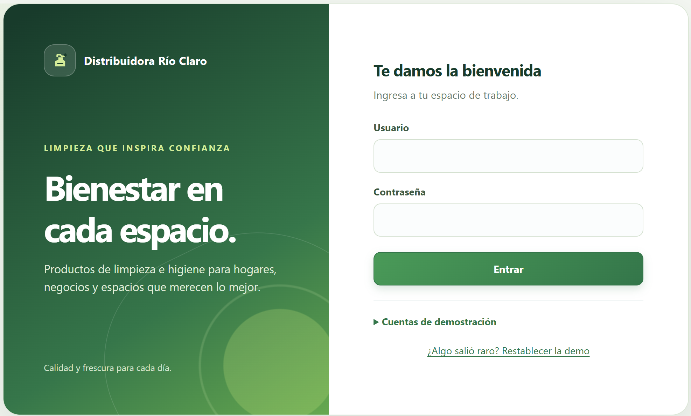

---

## 1. Resumen

Distribuidora Río Claro vende productos de limpieza desde cinco sucursales y tiene 140 empleados. El prototipo resuelve dos problemas del director general con servicios de Azure:

1. **Dejar de capturar facturas de proveedores a mano.** La captura manual consume unas 12 horas semanales y se equivoca en una de cada 20 facturas. El prototipo lee las facturas en PDF o foto con **Azure AI Document Intelligence**, valida reglas de negocio y deja la aprobación en manos de personas.
2. **Responder a clientes y empleados en minutos.** Un asistente con **gpt-4.1-mini (Azure AI Foundry)** consulta existencias, precios, pedidos y políticas, cita la fuente de cada respuesta y pasa el caso a una persona cuando no sabe.

Además, las quejas se analizan con **Azure AI Language** (sentimiento y frases clave), y todo el prototipo se apoya en seis principios de IA responsable con evidencia verificable dentro de la propia aplicación.

El prototipo es una aplicación web pública, publicada solo con herramientas de Azure: **Azure Storage** (sitio web estático), **Azure Functions** (API) y los servicios de IA mencionados.

---

## 2. Arquitectura

```
 Navegador (React 19 + Vite)
        │  HTTPS
        ▼
 Azure Storage · sitio web estático   ──►  strioclaroweb.z14.web.core.windows.net
        │
        │  fetch con token firmado (Bearer)  ·  CORS solo para este origen
        ▼
 Azure Functions (Consumo, Node 22)   ──►  rioclaro-api-sle
   login · health · extractInvoice · chat · analyzeComplaint · speechToken
        │
        ├──► Azure AI Document Intelligence (modelo prebuilt-invoice)
        ├──► Azure AI Foundry · Azure OpenAI (despliegue gpt-4.1-mini)
        ├──► Azure AI Language (sentimiento y frases clave)
        └──► Azure AI Speech (emisión de token de voz)

 GitHub Actions: pruebas → auditoría de seguridad → despliegue de frontend y API
```

**Decisiones de diseño**

- **El backend es un proxy delgado.** Las claves de Azure viven solo en las variables de la Function App; el navegador nunca las ve.
- **El modelo decide qué herramienta usar y la aplicación la ejecuta con los permisos de la persona.** El asistente nunca ve más de lo que el rol del usuario puede ver.
- **Las negativas de privacidad son deterministas y locales.** Nóminas, datos de empleados, datos de otros clientes e intentos de «ignora tus reglas» se rechazan en la aplicación, antes de llamar al modelo. Siguen funcionando si Azure falla y no consumen tokens.
- **Modo local y modo Azure con la misma interfaz.** Un interruptor (`VITE_USE_AZURE`) cambia los servicios simulados por llamadas reales al backend, sin tocar componentes ni reglas de negocio.

### Servicios de Azure utilizados

| Servicio | Para qué se usa | Dónde se ve |
|---|---|---|
| Azure AI Document Intelligence (`prebuilt-invoice`) | Leer proveedor, RFC, folio, fecha y total de facturas en PDF y foto, con la confianza de cada campo | Sección 4 |
| Azure AI Foundry · Azure OpenAI (`gpt-4.1-mini`) | Asistente conversacional con llamada a herramientas | Sección 5 |
| Azure AI Language | Sentimiento y frases clave de las quejas | Sección 5.3 |
| Azure AI Speech | El backend emite el token de voz (`speechToken`, probado con respuesta 200). La interfaz de voz queda como mejora. | Sección 9 |
| Azure Storage (sitio web estático) | Hospeda la aplicación web | Sección 8 |
| Azure Functions (plan de Consumo) y Application Insights | API y telemetría | Sección 8 |
| GitHub Actions | Pruebas, auditoría y despliegue automáticos | Sección 8 |

---

## 3. Datos de demostración

Datos ficticios coherentes con la empresa: 5 sucursales, 140 empleados, 2,000 clientes, 3,000 pedidos, 221 quejas, 320 registros de existencias, 64 productos unificados, 60 proveedores, 11 roles y 13 políticas (9 públicas y 4 internas). Hay 11 facturas de prueba (PDF y foto) que cubren los casos normales y los difíciles: duplicadas, de proveedor nuevo, borrosas y de monto alto.

---

## 4. Meta 1 · Lectura automática de facturas

### 4.1 Flujo

1. Finanzas sube la factura (PDF, JPG o PNG, hasta 10 MB).
2. El backend la envía a Document Intelligence y devuelve cinco campos, cada uno con su confianza.
3. La aplicación aplica las reglas de la política POL-10 y asigna un estado: **OK**, **Revisar** o **Duplicada**.
4. Una persona aprueba o rechaza. La IA nunca aprueba pagos.

### 4.2 Reglas de negocio

| Regla | Comportamiento |
|---|---|
| Proveedor | Se identifica por su **RFC contra el catálogo**, no por el nombre leído. Si el RFC coincide, el proveedor queda *validado por catálogo* y se muestra su razón social. |
| RFC ausente o fuera del catálogo | Pasa a **Revisar**; además exige 80 % de confianza en proveedor y RFC. |
| Confianza mínima por campo | Total 90 % · Fecha 80 % · Folio 60 %. Un dato faltante también lleva a **Revisar**. |
| Duplicados | Mismo RFC + folio + total, o mismo archivo (hash), aunque llegue en PDF y en foto. Se bloquea hasta que una persona decide. |
| Folio repetido con otro total | **Revisar**. |
| Aprobación | Finanzas aprueba cada factura. Pagos de más de $100,000.00 requieren **además** a Dirección, y debe ser otra persona. |
| Decisión final | Una factura aprobada o rechazada ya no cambia. |

### 4.3 Calibración con lecturas reales de Azure

Al probar el backend con las facturas de prueba, Azure leyó el PDF limpio así:

| Campo | Valor leído | Confianza |
|---|---|---|
| Proveedor | «CY» | 0.820 |
| RFC | CDO920402DFT | 0.723 |
| Folio | A-8841 | 0.798 |
| Fecha | 2026-10-06 | 0.983 |
| Total | 10,750.76 | 0.982 |

El nombre del proveedor salió abreviado y el RFC con confianza de 72 %. Con un umbral único de 80 % esta factura correcta habría ido a revisión manual. Por eso el proveedor se valida por su RFC contra el catálogo y los umbrales se fijaron **por campo** (el total, que es el dato de mayor riesgo, conserva el 90 %). La política POL-10 y la evidencia de IA responsable se actualizaron con este criterio.

La foto de la misma factura (RFC 0.821, folio 0.683, total 0.976) se detecta como **duplicada** del PDF. La factura borrosa devolvió únicamente el nombre del proveedor, sin RFC, folio, fecha ni total, y pasa a **Revisar** con los motivos.

### 4.4 Evidencia

**Factura correcta, validada por catálogo, con nombre estándar sugerido, aprobaciones pendientes e historial:**

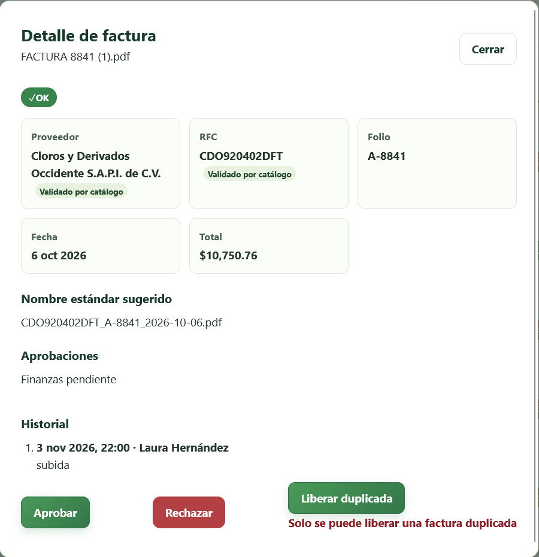

**Factura borrosa → Revisar, con los motivos explicados:**

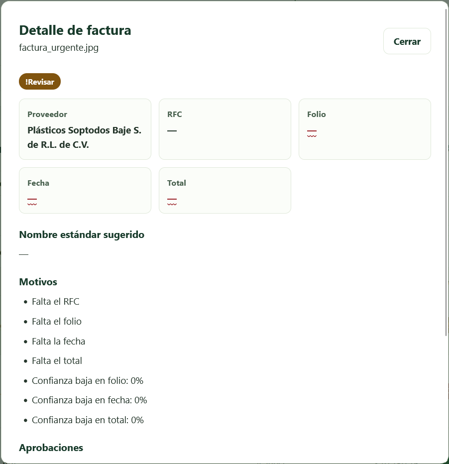

**Misma factura en PDF y foto → la segunda queda como Duplicada:**

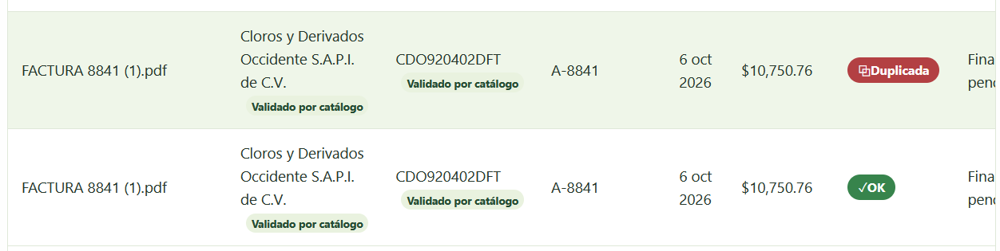

**Monto de $134,520.40 → aprobación de Finanzas y de Dirección (dos personas distintas), con historial. Después queda con decisión final:**

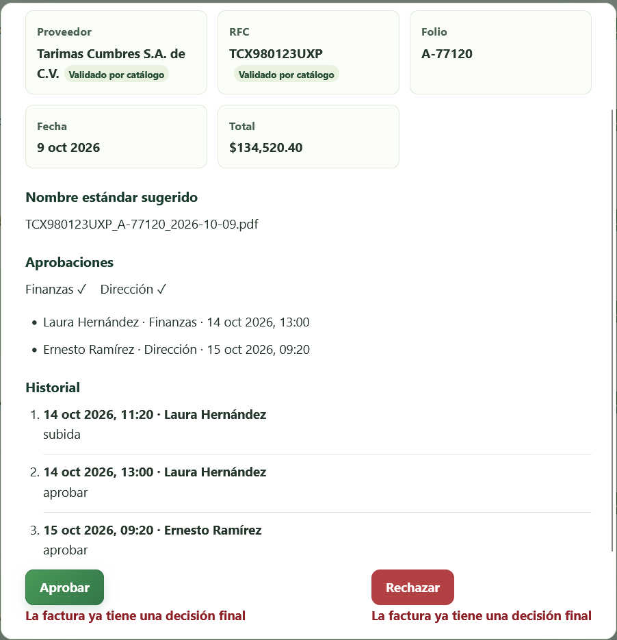

---

## 5. Meta 2 · Asistente que responde en minutos

### 5.1 Cómo funciona

- El modelo `gpt-4.1-mini` recibe lineamientos fijos y cinco herramientas: `consultar_existencias`, `consultar_precio`, `estado_pedido`, `buscar_politica` y `registrar_queja`.
- La aplicación ejecuta la herramienta **con los permisos de la persona** y devuelve al modelo solo el resultado mínimo necesario.
- Cada respuesta incluye su **fuente** (documento y versión, o corte de inventario). Si no hay información, ofrece pasar con una persona.
- Un cliente solo ve disponibilidad cualitativa de su sucursal y solo las 9 políticas públicas; un empleado ve lo que su rol permite.

### 5.2 Evidencia

**Existencias con fuente y fecha de corte** («¿cuánto cloro de litro nos queda?» → 203 unidades en Guadalajara, fuente Inventario v1.0):

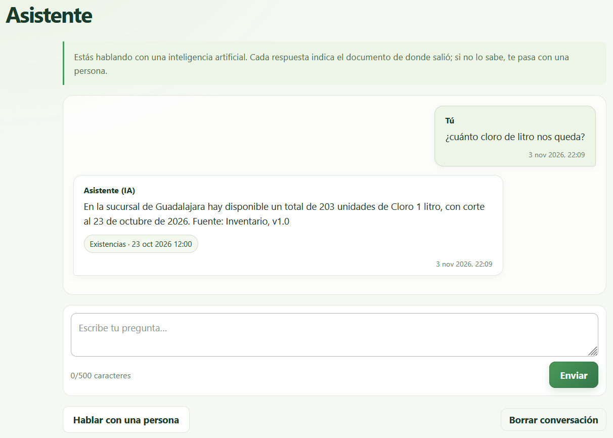

**Política con versión citada** («¿Cuántos días tengo para devolver?» → 15 días naturales, POL-01 v3.0):

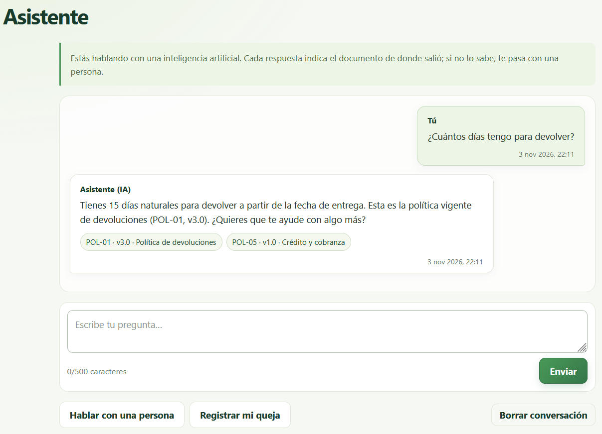

**Privacidad: la pregunta sobre salarios se rechaza en la aplicación, sin llamar al modelo:**

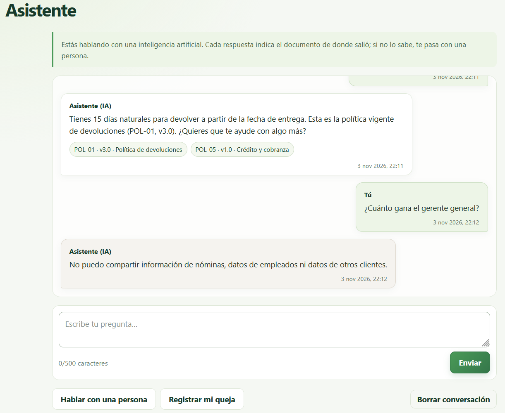

### 5.3 Quejas con análisis de sentimiento

Las quejas se registran desde el asistente o en la sección Quejas. El backend consulta Azure AI Language y la aplicación muestra sentimiento, confianza y frases clave. Si el servicio falla, la queja se marca «Sin analizar» y no se rompe nada.

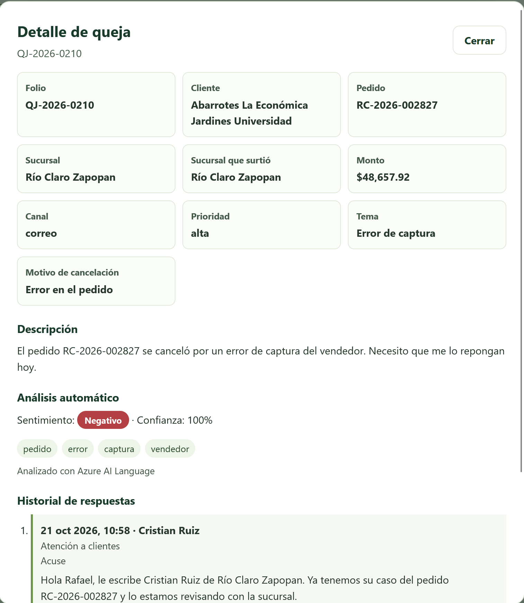

Para no gastar cuota ni frenar la interfaz, **el listado y el Panel no llaman a Azure AI Language**: usan un cálculo local marcado como estimado. El servicio se consulta una sola vez al abrir el detalle de una queja o al registrar una nueva, con caché y una solicitud simultánea como máximo. La captura siguiente muestra la lista de quejas cargada con la pestaña de red abierta: no hay ninguna solicitud a `analyzeComplaint`.

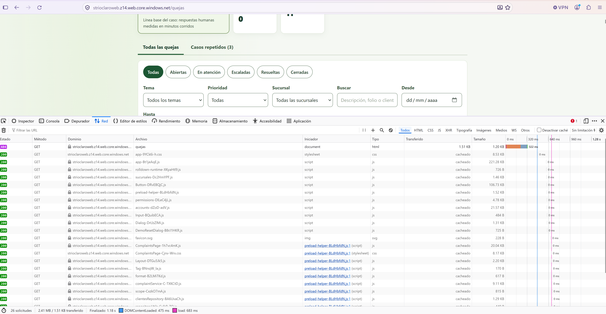

---

## 6. IA responsable

Los seis principios de Microsoft se aplican con medidas concretas y con evidencia que cualquiera puede ejecutar desde la sección **IA responsable** de la aplicación (24 comprobaciones; descarga un informe en Markdown).

| Principio | Qué hace el prototipo |
|---|---|
| **Equidad** | Mismas reglas y misma calidad de respuesta para las cinco sucursales. La comprobación EQ-1 hace la misma pregunta de existencias en las 5 sucursales y compara con el repositorio. |
| **Fiabilidad y seguridad** | Umbral de confianza por campo, revisión humana de lo dudoso, bloqueo de duplicados, rechazo de intentos de inyección de instrucciones y «no encontré esa información» en lugar de inventar. |
| **Privacidad y seguridad** | Negativas deterministas para nóminas y datos ajenos, permisos por rol en cada herramienta, ningún dato salarial ni RFC de empleados en el paquete publicado, secretos solo en Azure, registros de la API solo con metadatos. |
| **Inclusión** | Interfaz y respuestas en español de México con lenguaje claro; los estados usan texto y símbolo, no solo color (✓ OK, ! Revisar, Duplicada). |
| **Transparencia** | Aviso permanente «Estás hablando con una inteligencia artificial», fuente y versión en cada respuesta, y confianza visible en cada campo de la factura. |
| **Responsabilidad** | La IA no aprueba pagos ni facturas. Hay historial de quién hizo qué, doble aprobación de Dirección sobre $100,000 y una política interna de uso del asistente (POL-08). |

**Resultado de la página de IA responsable:** 24 comprobaciones; 21 locales aprobadas, 0 con atención, 2 pendientes de Azure y 1 revisión manual.

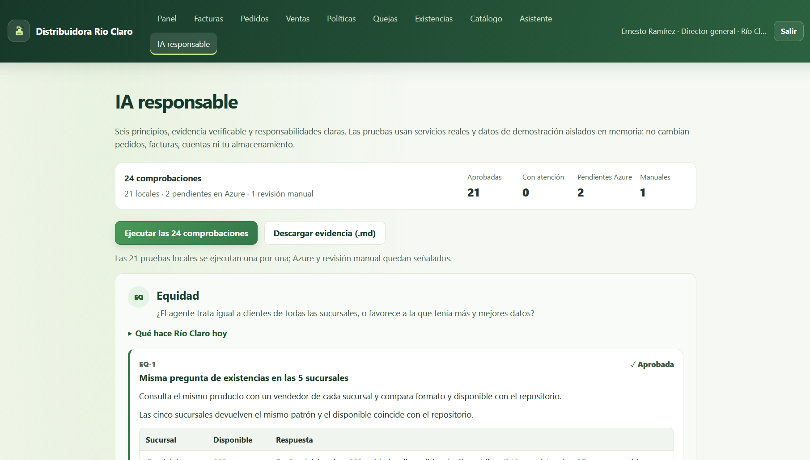

Las 2 comprobaciones pendientes de Azure se cubren con la prueba de integración contra los servicios reales (sección 7).

---

## 7. Pruebas y verificación

| Verificación | Resultado |
|---|---|
| Pruebas automáticas (Vitest) | 475 aprobadas, 1 omitida |
| Prueba contra Azure real (`npm run api:probar`) | 14 de 14: login, rechazos 401, tres facturas leídas por Document Intelligence, chat con llamada a herramienta, rechazo de mensajes `system`, análisis de quejas y token de voz |
| Verificación del paquete publicado (`verificar:azure`) | 8 de 8: sin contraseñas de demostración, sin datos salariales, sin RFC ni correos de empleados |
| Auditoría de seguridad (`auditar:seguridad`) | 7 de 7 comprobaciones aprobadas (sección 8) |
| Despliegue continuo | Tres ejecuciones del workflow en verde (sección 9) |

---

## 8. Seguridad

La auditoría `npm run auditar:seguridad` se ejecuta también en el flujo de despliegue. El detalle está en `docs/SEGURIDAD.md`.

| Comprobación | Resultado |
|---|---|
| Secretos en archivos versionados | OK |
| Secretos y datos sensibles en el paquete publicado | OK |
| Historial de Git sin archivos de configuración local | OK |
| `.gitignore` y `.env.azure` (solo dos variables públicas) | OK |
| Registros de la API solo con metadatos | OK |
| Autenticación, roles, límite de intentos y `health` sin valores de configuración | OK |
| Comprobaciones de privacidad de IA responsable (6/6) | OK |

**Pruebas manuales sobre el servicio publicado**

- Una llamada al chat sin sesión devuelve **401**.
- Una solicitud de CORS desde un origen ajeno recibe **400**; desde el sitio legítimo recibe **200** con `Access-Control-Allow-Origin` apuntando solo a él.

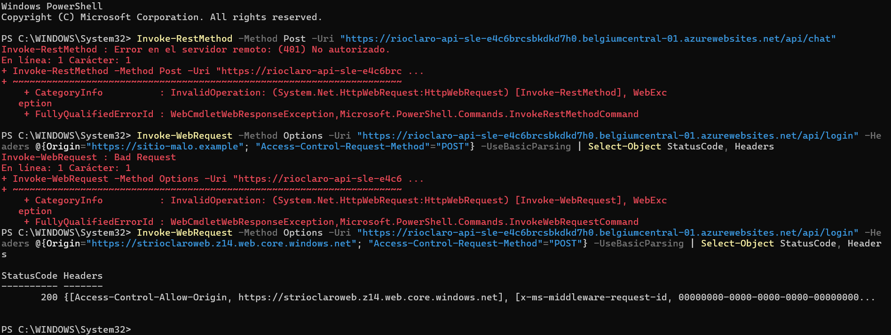

- El paquete publicado no contiene claves ni contraseñas de demostración. Lo comprueban `verificar:azure` (8 de 8) y `auditar:seguridad` en cada despliegue.


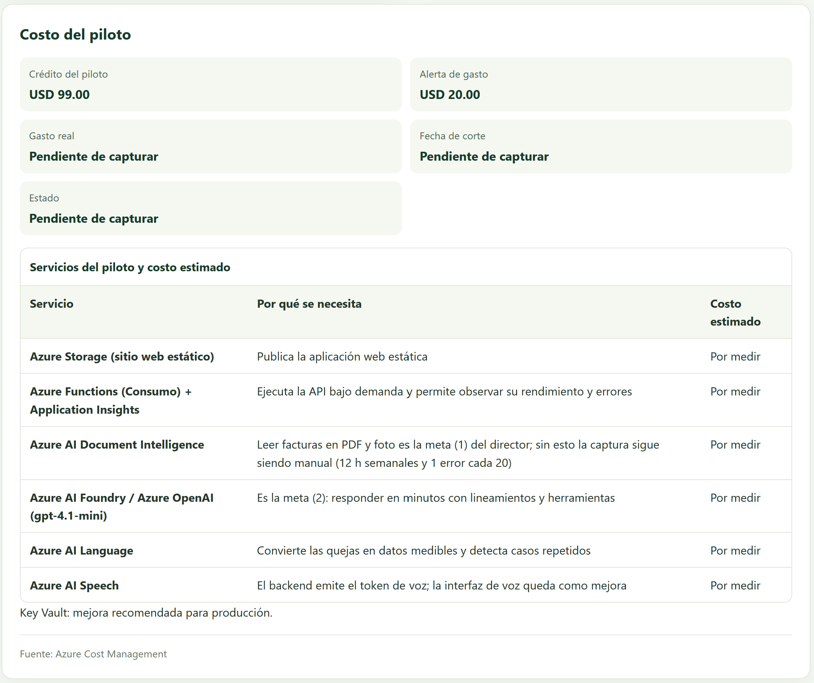


---

## 9. Despliegue

El código vive en GitHub y cada `push` a `main` ejecuta el flujo de trabajo **Desplegar sitio y API de Río Claro**:

1. **Pruebas:** instalación limpia, 475 pruebas, compilación en modo Azure, verificación del paquete y auditoría de seguridad.
2. **Frontend:** sube el sitio al contenedor `$web` de la cuenta de almacenamiento `strioclaroweb`.
3. **API:** empaqueta las dependencias de producción y publica la Function App `rioclaro-api-sle`.

Los secretos (`AZURE_STORAGE_CONNECTION_STRING`, `AZURE_FUNCTIONAPP_PUBLISH_PROFILE`) están en GitHub Actions; las claves de los servicios de IA y el `TOKEN_SECRET` están solo en la configuración de la Function App.

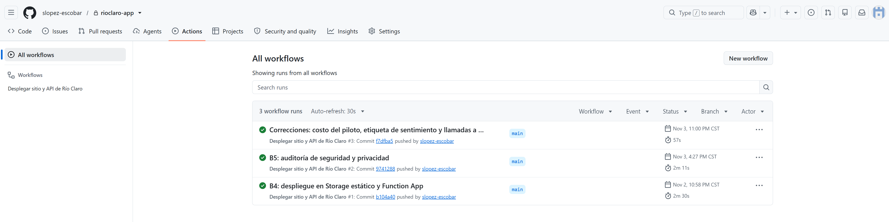

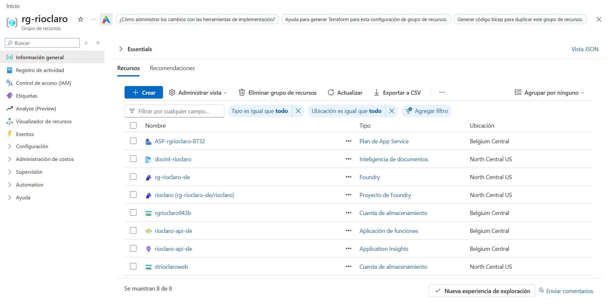

**Recursos en el grupo `rg-rioclaro`:** cuenta de almacenamiento del sitio (`strioclaroweb`), Function App con su plan y Application Insights, Document Intelligence (`docint-rioclaro`) y Foundry con su proyecto (`rg-rioclaro-sle`, modelo `gpt-4.1-mini`). Los recursos de Azure AI Language y Azure AI Speech son de la misma suscripción y se reutilizaron.

**Nota sobre regiones.** La suscripción Azure for Students solo permite crear recursos en cinco regiones (North Central US, Norway East, Mexico Central, Belgium Central y Denmark East). Azure Static Web Apps no está disponible en ninguna de ellas, por lo que el prototipo usa un sitio estático en Azure Storage más Azure Functions, con CORS restringido al origen del sitio.

---

## 10. Costos

El piloto se ejecuta con el crédito de USD 99 de Azure for Students, con una alerta de gasto configurada en USD 20. Todos los servicios son de consumo o de costo mínimo (Functions en plan de Consumo, Document Intelligence, Language y modelo mini facturados por uso, y almacenamiento estático). El asistente evita gasto innecesario de dos maneras: las negativas de privacidad se resuelven en la aplicación sin llamar al modelo, y el análisis de sentimiento solo se consulta al abrir el detalle de una queja.

---

## 11. Límites conocidos y mejoras para producción

| Límite del prototipo | Mejora en producción |
|---|---|
| Las cuentas de demostración viven en un archivo y comparten contraseña; el brief permite este esquema | Microsoft Entra ID con roles y contraseñas individuales |
| Las acciones del usuario (aprobaciones, quejas nuevas, cuentas desactivadas) se guardan en el `localStorage` de cada navegador | Base de datos (Azure SQL o Cosmos DB) y API de escritura |
| Los datos de negocio viajan en el paquete publicado y se filtran en el cliente por rol | Que el backend entregue solo los datos permitidos a cada rol |
| Las claves están como variables de la Function App | Azure Key Vault con identidad administrada |
| La interfaz de voz no se incluyó (el backend ya emite el token de Speech) | Entrada y salida de voz para atención telefónica |
| El análisis de sentimiento no se almacena de forma centralizada | Guardar el resultado junto con la queja |
| Al cargar o recargar una ruta interna (por ejemplo `/panel`) el navegador registra un código 404, porque el sitio estático de Storage sirve `index.html` como documento de error; la aplicación se muestra con normalidad | Azure Front Door o CDN con reescritura de rutas |
| Node 22 llega a fin de soporte el 30 de abril de 2027 | Actualizar el runtime de la Function App |
| El plan de Consumo tiene arranque en frío | Plan Premium o Flex Consumption con instancias reservadas |

---

## 12. Guion para probar el prototipo (5 minutos)

1. Abrir https://strioclaroweb.z14.web.core.windows.net/ y entrar con `laura` / `demo123`.
2. **Facturas →** subir `FACTURA 8841 (1).pdf` de la carpeta `facturas-prueba`: se leen los cinco campos y el proveedor queda *validado por catálogo*. Subir de nuevo la foto `20261016_091523.jpg`: queda **Duplicada**. Subir `factura_urgente.jpg`: queda en **Revisar** con motivos.
3. Abrir una factura mayor a $100,000: Finanzas aprueba y falta Dirección (otro usuario).
4. Cerrar sesión y entrar como `cliente1`. **Asistente →** «¿Cuántos días tengo para devolver?» (cita POL-01 v3.0) y «¿Cuánto gana el gerente general?» (se rechaza).
5. Entrar como dirección → **IA responsable →** «Ejecutar las 24 comprobaciones» y «Descargar evidencia (.md)».

---

## Apéndice A · Variables de entorno de la Function App (solo nombres)

`TOKEN_SECRET`, `AOAI_ENDPOINT`, `AOAI_KEY`, `AOAI_DEPLOYMENT`, `DOCINT_ENDPOINT`, `DOCINT_KEY`, `LANGUAGE_ENDPOINT`, `LANGUAGE_KEY`, `SPEECH_REGION`, `SPEECH_KEY`.

## Apéndice B · Problemas encontrados y cómo se resolvieron

| Problema | Solución |
|---|---|
| El chat devolvía 422 al probar contra Azure sin indicar la causa | Se añadió registro de metadatos del error del proveedor (sin contenido) y mapeo de errores; la causa era el endpoint del recurso de Foundry |
| Umbral de 80 % rechazaba una factura correcta (RFC leído con 72 %) | Proveedor validado por RFC contra el catálogo y umbrales por campo (sección 4.3) |
| Static Web Apps y otras regiones bloqueadas por la política de la suscripción | Sitio estático en Azure Storage + Azure Functions en una región permitida |
| El plan Consumo no se podía crear en North Central US (`ServerFarmCreationNotAllowed`) | Se creó en Belgium Central |
| `datos:check` fallaba por una política faltante en la fuente de datos | Se restableció la fuente y se regeneraron los artefactos |
| El Panel de dirección y la lista de quejas disparaban cientos de solicitudes al servicio de sentimiento (696 solicitudes con 221 quejas) | Cálculo local estimado en listados y consulta a Azure AI Language solo al abrir el detalle o registrar una queja, con caché y una solicitud simultánea |
| El despliegue de la API falló una vez con 503 mientras la Function App se reiniciaba | Se repitió el job fallido y pasó; los tres despliegues quedaron en verde |
